# Design „Milchglas“ – Entwurf vom 31. Oktober 2026

Gerenderte Entwürfe aus dem Design-Canvas „Foody Design“ (Handy, 411 dp breit), Standardfarbe Mango.
Grundlage: Oberfläche Milchglas, Formen Rund, Farbe frei wählbar unter Einstellungen › Erscheinungsbild.

## Bildschirme

| Bildschirm | Hell | Dunkel |
|---|---|---|
| Heute | 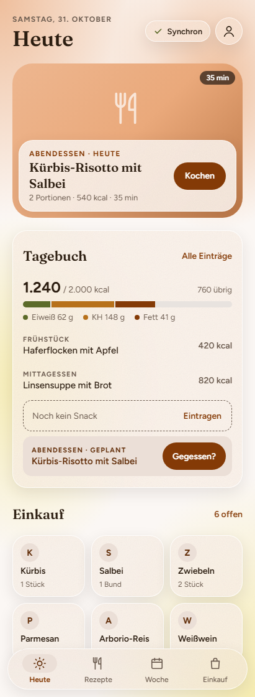 | 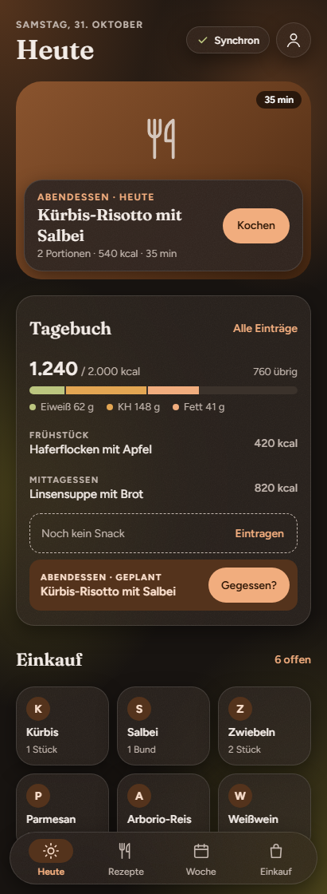 |
| Rezepte | 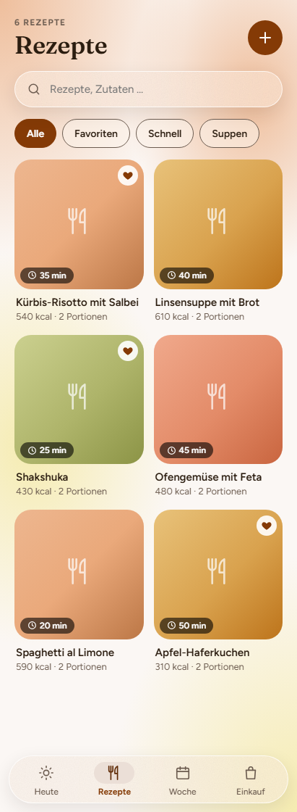 | 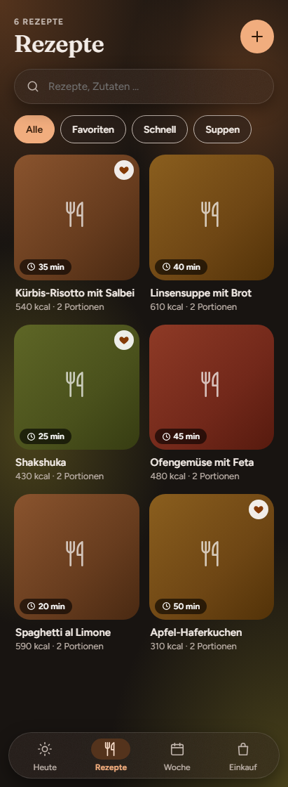 |
| Rezept (Detail) | 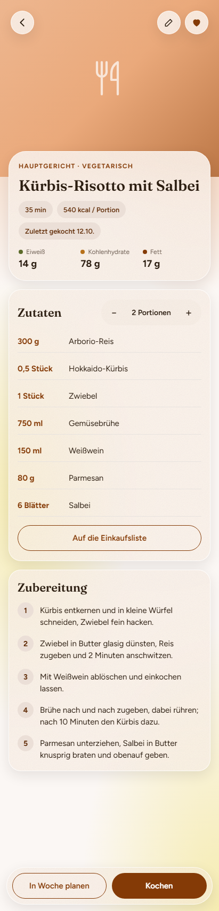 | 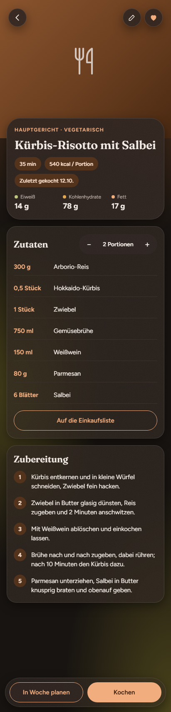 |
| Kochen | 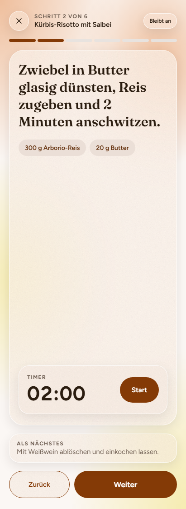 | 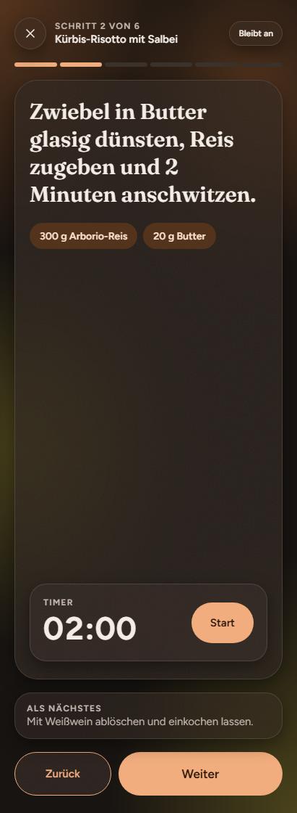 |
| Woche | 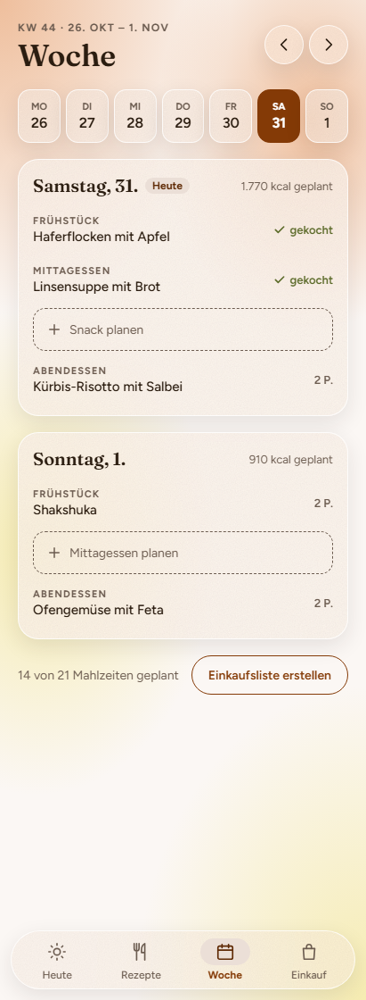 | 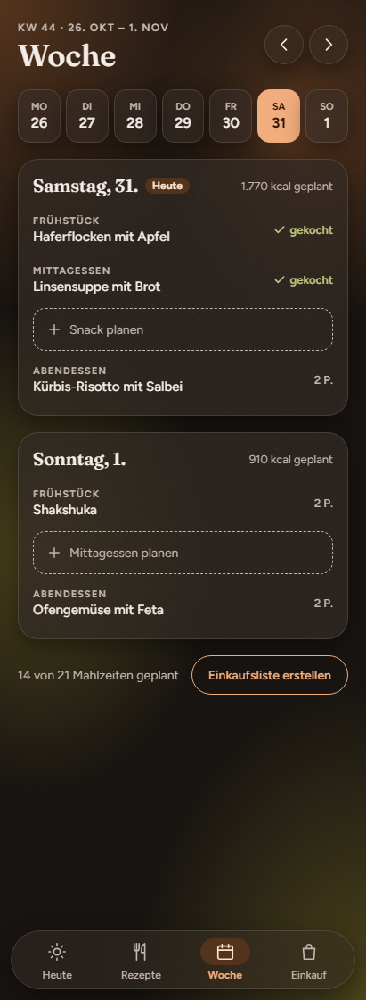 |
| Einkauf | 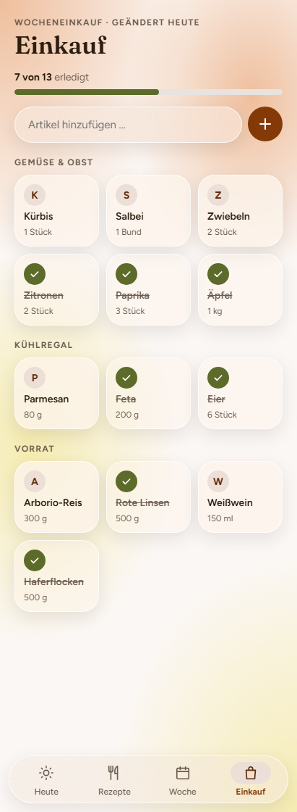 | 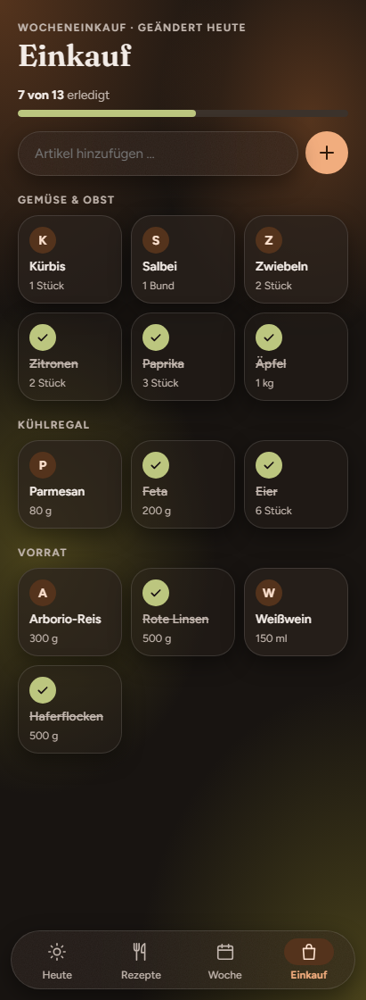 |
| Tagebuch (Tag) | 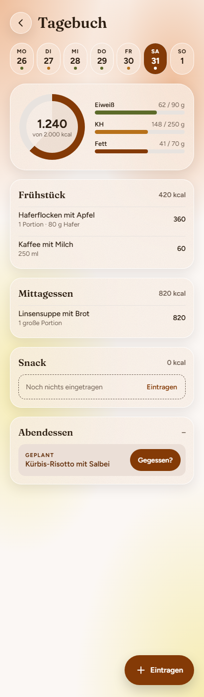 | 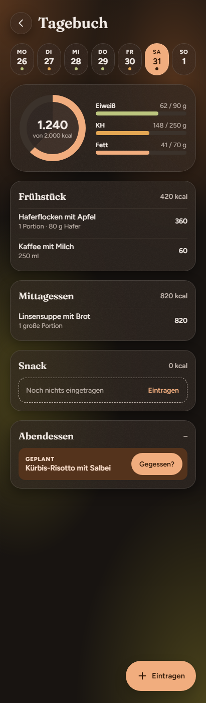 |
| Einstellungen | 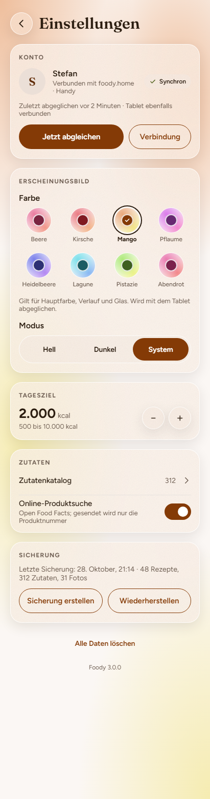 | 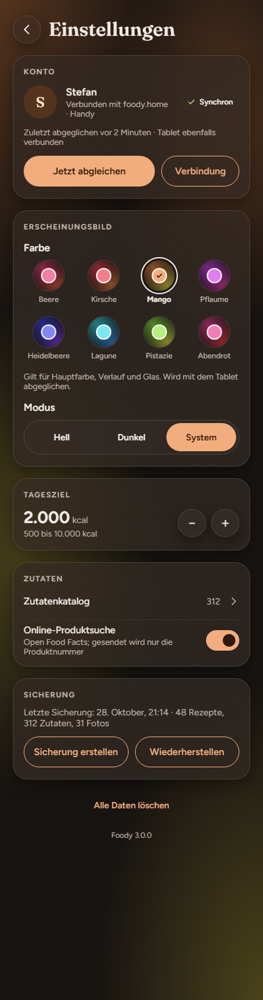 |
| Server verbinden | 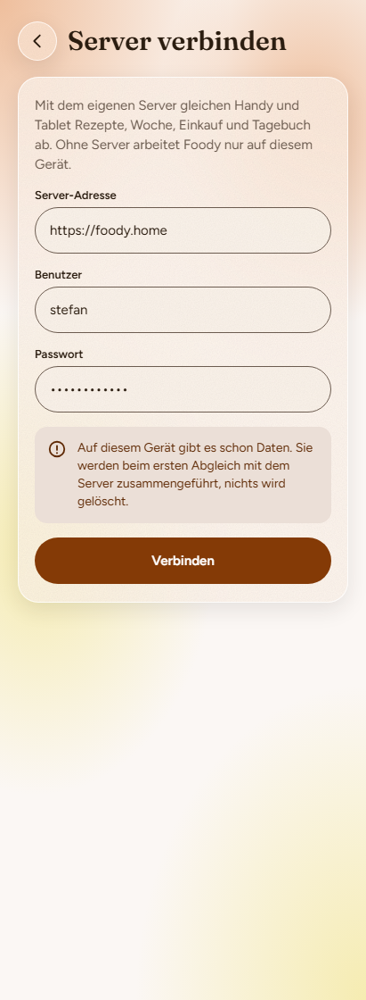 | 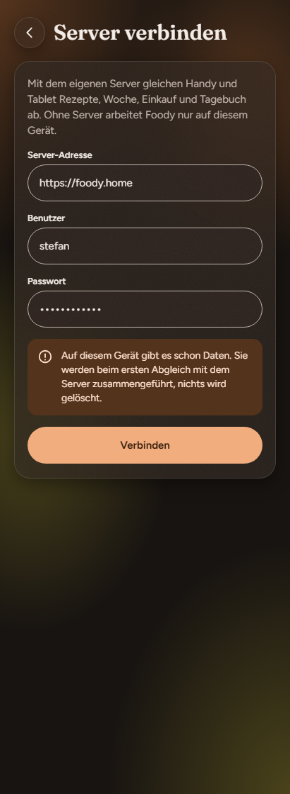 |
| Zutatenkatalog | 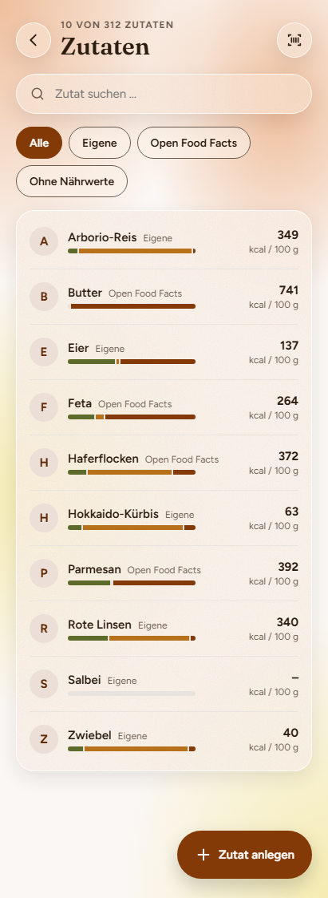 | 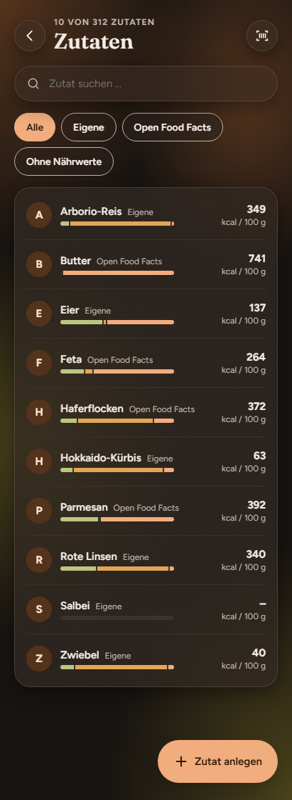 |

## Material und Formen

- **Milchglas:** Glasflächen mit Unschärfe 40 dp, feinem Korn (Rauschen 8 % hell, 5 % dunkel) und Lichtkante (weiß 78 % hell, 12 % dunkel). Deckkraft leicht 0,55/0,50, dicht 0,78/0,72, auf Bildern 0,92. Glas ist mit 4 % der Hauptfarbe getönt.
- **Verlauf:** Ton 1 oben links, Ton 2 unten rechts über dem Grund, beide aus der Hauptfarbe (Ton 2 um 28° verschoben, bei Grün Richtung Gelb). Die Bilder zeigen den Canvas mit zwei zusätzlichen Flecken; die App bleibt bei zwei, weil überlagerte Flecken den Kontrast unter AA drücken.
- **Formen Rund:** Ecken klein 14 dp, mittel 23 dp, groß 32 dp, Leiste 39 dp; Knöpfe, Chips und Kreise als Pille.

## Farben (Stand App)

Maßgeblich ist `Farbwelt.kt` in `:core:designsystem`; der Kontrast-Test prüft jede Farbwelt hell und dunkel (WCAG 2.2 AA ohne Unschärfe, gegen Grund und volle Stellen des Verlaufs, Glas per Alpha gemischt; Text ≥ 4,5 : 1, Grafik ≥ 3 : 1). Gegenüber den Bildern ist der Nebentext im hellen Modus etwas dunkler, weil er auch direkt auf dem Verlauf AA halten muss.

### Hell

| Farbwelt | Grund | Text | Nebentext | Primär | Auf Primär | Behälter | Auf Behälter | Oliv | Safran | Spur | Verlauf oben | Verlauf unten | Glas |
|---|---|---|---|---|---|---|---|---|---|---|---|---|---|
| Beere | `#FBF4F6` | `#2A1A1E` | `#4E4144` | `#7A2440` | `#FFFFFF` | `#EADCE0` | `#581A2E` | `#5C6B2A` | `#A76718` | `#E8E0E3` | `#EA7B9F α 0.72` | `#F29788 α 0.62` | `#FAF2EC` |
| Kirsche | `#FBF4F4` | `#2B1717` | `#524041` | `#801921` | `#FFFFFF` | `#EBDADB` | `#5C1218` | `#5C6B2A` | `#A76718` | `#E8E0E0` | `#EA7B84 α 0.72` | `#F2B188 α 0.62` | `#FBF1EB` |
| Mango (Standard) | `#FBF7F4` | `#2B1D10` | `#5D4F45` | `#843A06` | `#FFFFFF` | `#EBDFD7` | `#5F2A05` | `#5C6B2A` | `#B26E19` | `#E8E3DF` | `#EAA97B α 0.72` | `#F2E588 α 0.62` | `#FCF3EA` |
| Pflaume | `#FAF4FB` | `#24182A` | `#4E4350` | `#672971` | `#FFFFFF` | `#E7DDE8` | `#4B1E51` | `#5C6B2A` | `#A76718` | `#E7E0E8` | `#DB7BEA α 0.72` | `#F288CE α 0.62` | `#F9F2EE` |
| Heidelbeere | `#F4F4FB` | `#1A1B2E` | `#3A3A46` | `#2E3174` | `#FFFFFF` | `#DEDEE9` | `#212454` | `#5C6B2A` | `#A26317` | `#E0E0E9` | `#7B80EA α 0.72` | `#B488F2 α 0.62` | `#F7F3EF` |
| Lagune | `#F4FAFB` | `#132426` | `#4A595A` | `#1B5C63` | `#FFFFFF` | `#DBE5E6` | `#144247` | `#5C6B2A` | `#B26D19` | `#E0E7E8` | `#7BDFEA α 0.72` | `#88B6F2 α 0.62` | `#F6F4ED` |
| Pistazie | `#F7FBF4` | `#1C2414` | `#5C6555` | `#3E6020` | `#FFFFFF` | `#E0E6DB` | `#2D4517` | `#5C6B2A` | `#BD741B` | `#E3E8E0` | `#AFEA7B α 0.72` | `#EBF288 α 0.62` | `#F7F4EB` |
| Abendrot | `#FBF4F7` | `#2A1820` | `#514249` | `#7A224C` | `#FFFFFF` | `#EADCE2` | `#581837` | `#5C6B2A` | `#A76718` | `#E8E0E4` | `#EA7BB0 α 0.72` | `#F28889 α 0.62` | `#FAF2ED` |

### Dunkel

| Farbwelt | Grund | Text | Nebentext | Primär | Auf Primär | Behälter | Auf Behälter | Oliv | Safran | Spur | Verlauf oben | Verlauf unten | Glas |
|---|---|---|---|---|---|---|---|---|---|---|---|---|---|
| Beere | `#181113` | `#F3E7EB` | `#C2AEB4` | `#F17EA3` | `#300815` | `#541C2E` | `#FCCFDD` | `#BCC67F` | `#E3A653` | `#3B2B30` | `#862746 α 0.55` | `#863527 α 0.45` | `#2B1D21` |
| Kirsche | `#181111` | `#F3E7E8` | `#C2AEAF` | `#F17E88` | `#30080C` | `#541C21` | `#FCCFD2` | `#BCC67F` | `#E3A653` | `#3B2B2D` | `#86272F α 0.55` | `#864C27 α 0.45` | `#2B1D1E` |
| Mango (Standard) | `#181411` | `#F3ECE7` | `#C2B6AE` | `#F1AD7E` | `#301908` | `#54331C` | `#FCE1CF` | `#BCC67F` | `#E3A653` | `#3B322B` | `#864E27 α 0.55` | `#867B27 α 0.45` | `#2B221D` |
| Pflaume | `#171118` | `#F2E7F3` | `#BFAEC2` | `#E07EF1` | `#2A0830` | `#4C1C54` | `#F6CFFC` | `#BCC67F` | `#E3A653` | `#382B3B` | `#792786 α 0.55` | `#862768 α 0.45` | `#291D2B` |
| Heidelbeere | `#111118` | `#E7E7F3` | `#AEAFC2` | `#8D91F2` | `#080A30` | `#1C1F54` | `#CFD1FC` | `#BCC67F` | `#E3A653` | `#2B2C3B` | `#272B86 α 0.55` | `#4F2786 α 0.45` | `#1D1D2B` |
| Lagune | `#111718` | `#E7F2F3` | `#AEC0C2` | `#7EE6F1` | `#082C30` | `#1C4F54` | `#CFF8FC` | `#BCC67F` | `#E3A653` | `#2B393B` | `#277E86 α 0.55` | `#275186 α 0.45` | `#1D2A2B` |
| Pistazie | `#141811` | `#EDF3E7` | `#B7C2AE` | `#B4F17E` | `#1B3008` | `#36541C` | `#E4FCCF` | `#BCC67F` | `#E3A653` | `#323B2B` | `#548627 α 0.55` | `#808627 α 0.45` | `#232B1D` |
| Abendrot | `#181114` | `#F3E7ED` | `#C2AEB7` | `#F17EB5` | `#30081B` | `#541C37` | `#FCCFE5` | `#BCC67F` | `#E3A653` | `#3B2B33` | `#862755 α 0.55` | `#862728 α 0.45` | `#2B1D23` |
